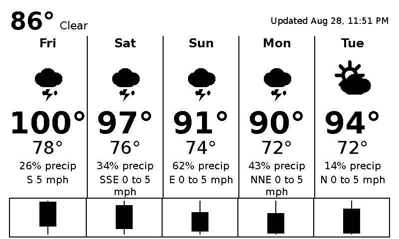

# trmnl-weather

Minimal, 1‑bit friendly 5‑day forecast for the TRMNL display (800×480). Pure HTML/CSS/JS with inline SVG icons and no runtime dependencies.

## Screenshot

**What it does**
- Renders a header with current temperature/conditions and last‑updated time
- Shows 5 days with icon, high/low, precip %, and wind
- Draws per‑day temperature range bars along the bottom
- Uses black/white only for crisp e‑paper screenshots

## Quick Start

Paste the html/javascript into the TRMNL console, fetch the JSON via API.

TRMNL injects data via Liquid variables. Drop `index.html` into your TRMNL app and map your data to the following Liquid values:
- `{{current|json}}`
- `{{forecast|json}}` (expects NOAA‑style `periods` with `isDaytime`)
- `{{location|json}}`

No external fonts or libraries are required.

## Data Shape

The renderer is flexible, but the simplest input is NOAA/NWS style:
- `current.timestamp`, `current.temperature.value`, `current.description`
- `forecast.periods[]` with `isDaytime`, `startTime`, `temperature`, optional `probabilityOfPrecipitation.value`, `windSpeed`, `windDirection`, `shortForecast`

`normalizeForecast(...)` also accepts alternative keys commonly returned by other APIs (e.g., `daily[]` with `high/low/pop/wind*`).

## Notes

- Designed for 800×480; fonts and line weights are tuned for readability from a distance.
- Icons are inline SVG; strokes use `vector-effect: non-scaling-stroke` for crisp rendering.
- Everything is self‑contained to simplify TRMNL deployment and screenshots.

## Fun view (`fun.html`)

An alternate, self-contained view using the same Liquid data. The left half is an American Gothic style 1-bit line drawing of the two of us in front of a farmhouse, dressed for today's forecast period (tonight's after dark):

- Clothing by temperature: tank tops (90°+), t-shirts (72°+), long sleeves (45°+), coats and hats below that (scarves below 32°)
- Sky by forecast: sun + sunglasses, clouds, rain + umbrella, lightning, snow, fog, wind lines; black starry sky at night with the true moon phase (Meeus algorithm, accurate to minutes) and a big glowing moon on the night of the full moon
- Rare easter eggs (about 1 hour in 10, stable within the hour): owl on the roof, airplane, hot air balloon, geese, shooting star, UFO, kite, rainbow, snowman, cat in the window, a bird on his head, Bigfoot behind the tree, a deer, a rabbit, a formation of Black Hawk helicopters
- Seasonal touches: party hats on Feb 17 and Jul 13, pumpkin in late October, wreath in December, fireworks on July 4 and New Year's

The right half shows:

- High and low (today's high + tonight's low; after dark, tomorrow's high), with a thermometer icon
- Precipitation chance for the current period (the drop icon fills to match) and the expected amount: rain, snow, or ice in inches from the API's per-period `precipitation` field, falling back to amounts NWS mentions in the detailed forecast ("rainfall amounts between a quarter and half of an inch") when that field is missing
- Sunrise and sunset, calculated from `location.latitude`/`longitude`
- **Heads Up**: 1 to 3 one-line highlights from rules over the next 6 days: severe storms, storms, snow/ice, rain, freezes, big temperature swings (15°+), wind (25 mph or gusts 35+), fog (patchy, areas of, or dense, with timing like "before 9am"), and heat (100° or heat index 108+). Each rule picks its most significant period; the top 3 by importance (nearer days win ties) are shown in time order. Rain items include the expected amount ("Heavy rain" at 1 inch+ in one period). Active NWS alerts from the API's `alerts` field (marked with a black warning triangle) rank above the rules by severity, e.g. "Flood Watch until tomorrow 6pm" or "Freeze Warning Sunday night, low of 29°"; an alert replaces a rule item of the same kind for the same period and keeps its numbers. Quiet weeks get a single "Dry and quiet through ..." line. Thresholds are constants at the top of the highlights code. Both `alerts` and `precipitation` are optional, so the view still works with data that lacks them.

## License

MIT — see `LICENSE`.
